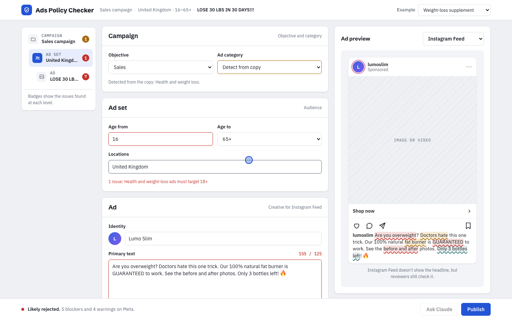
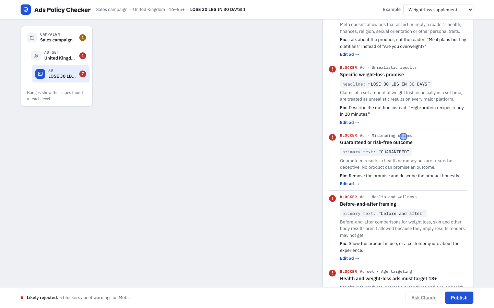

# Ads Policy Checker

A pre-flight check for ad copy. Paste an ad, and it flags what Meta, Google Search or TikTok reviewers are likely to reject, names the policy each issue breaks, and suggests a fix, before you spend money on a rejected ad.

**Live demo:** https://tim-fluxtech.github.io/ads-policy-checker/
**Video walkthrough (73 s):** [docs/demo.mp4](docs/demo.mp4)



## What it does

- **Ads Manager-style editor.** Campaign › Ad set › Ad, with objective, ad category, age range, locations, identity, primary text, headline, call to action and website URL. Each level shows a badge with its number of issues.
- **Placement previews.** Instagram Feed, Instagram Stories, Facebook Feed, Google Search and TikTok, with risky phrases underlined in the ad itself.
- **Policy review.** A verdict (Likely rejected, Needs changes or Ready to submit), an approval score, and every issue with the policy area, the exact words that triggered it, why it matters and how to fix it.
- **Cross-platform comparison.** The same ad is checked against all three platforms at once, because the rules differ. For example, TikTok bans weight-loss supplements and Google rejects exclamation marks in headlines.
- **Publish gate.** Publishing is blocked while blockers remain. Nothing is ever sent to an ad platform.
- **Claude second opinion.** When the page is opened inside Claude, Claude reviews the ad in context, finds risks the rules missed, and writes a compliant rewrite. One click applies the rewrite and the rules run again.



## How it works

1. **Rules engine.** 25 pattern rules and 3 whole-ad checks run in the browser on every keystroke. They cover personal attributes, unrealistic health and money claims, clickbait, restricted and prohibited categories (crypto, gambling, alcohol, tobacco, CBD, prescription drugs, adult content), special ad categories, editorial style (capitalization, punctuation, emoji, phone numbers), length limits, landing pages and age targeting. Each rule has its own severity per platform.
2. **Category detection.** The ad category is detected from the copy unless you set it, and it changes how strict some rules are. A guarantee in a coffee ad is a warning, but in a health or finance ad it's a blocker.
3. **LLM review.** The ad and the rule findings go to Claude with a structured prompt that asks for JSON: extra issues and a rewrite within the platform's character limits. The response is validated before it's shown.

## Run it

It's one HTML file with no build step and no dependencies.

```bash
git clone https://github.com/Tim-fluxtech/ads-policy-checker.git
open ads-policy-checker/index.html
```

The rules engine works in any browser. The Claude review only runs when the page is opened as a Claude artifact.

## Limitations

- The rules are a simplified reading of public advertising policies. Policies change often and differ by country, so this is a pre-flight check, not a platform decision.
- Images and video aren't checked. Only copy, targeting and the landing page URL are.
- Pattern rules can't understand context. That's what the Claude review step is for.

## How I built it

I built this with AI coding agents (Claude Code). I defined the problem, the rule set, the review flow and the Ads Manager-style interface, directed the build in short iterations, and tested every example across all five placements. Testing found a hidden-button bug and a mobile layout issue, and both were fixed before release.

Policy references: [Meta Advertising Standards](https://transparency.meta.com/policies/ad-standards/) · [Google Ads policies](https://support.google.com/adspolicy/answer/6008942) · [TikTok advertising policies](https://ads.tiktok.com/help/article/tiktok-advertising-policies-ad-creatives-landing-page)
